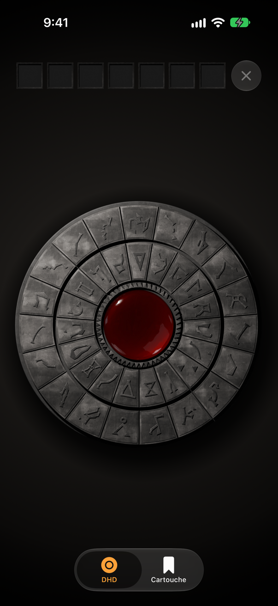
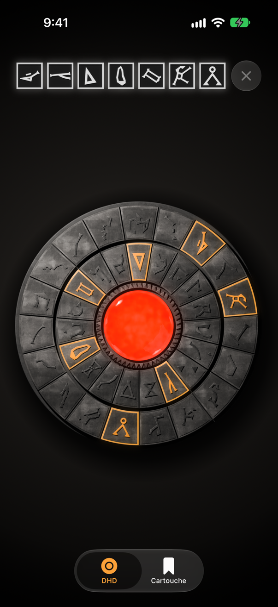
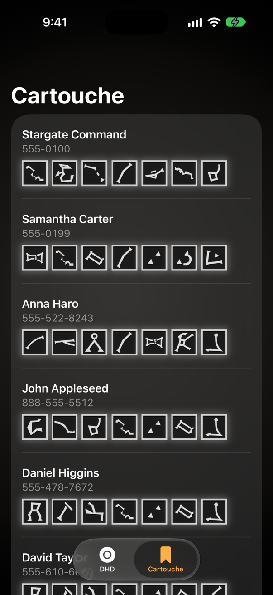

# Dial Home Device (iOS)

Dial a 7-glyph Stargate address to call the contact saved for it; unknown addresses can be saved to a contact in the
Cartouche.

| DHD | Dialed | Cartouche |
|:---:|:---:|:---:|
| <a href="./docs/screenshots/dhd.png"></a> | <a href="./docs/screenshots/dialed.png"></a> | <a href="./docs/screenshots/cartouche.png"></a> |

## Usage

- **Dial:** tap glyphs on the DHD. Each one lights up and appears in the chevron row at the top. ✕ clears the sequence.
- **Engage:** after seven glyphs, tap the red dome. If the address is saved, the phone app is opened to call that
  contact (iOS asks for confirmation) and the DHD resets.
- **Save:** for an unknown address, a sheet shows the address; choose *Save to Contact…* and pick a contact. If the
  contact has several numbers, pick one. A banner confirms the save. *Discard* clears the address; swiping the sheet
  away keeps it, and tapping the dome again brings the sheet back. Contacts are picked with the system picker, so the
  app needs no Contacts permission.
- **Cartouche:** the second tab lists saved addresses, searchable by name, phone number or glyph name. Swipe right
  and tap *Dial* (or long-press and choose *Dial*) to re-dial one: the app switches to the DHD and dials its glyphs one
  per second; then tap the dome. ✕ stops a re-dial. Swipe left and tap *Delete*, or long-press and choose *Delete*, to
  remove an address.
- **VoiceOver:** each glyph key and the dome are separate buttons; chevrons read out the dialed glyph names.

## Getting started

Requirements:

- Xcode 27+ (App Store uploads require a recent Xcode)
- iOS 17.0+ deployment target
- [XcodeGen](https://github.com/yonaskolb/XcodeGen): `brew install xcodegen`

The `.xcodeproj` is generated from `project.yml` and not committed. The signing team is read from the gitignored
`Config/Signing.local.xcconfig`; the simulator builds and tests without it.

```bash
git clone https://github.com/cowbellerina/mobile-dhd.git
cd mobile-dhd
cp Config/Signing.local.xcconfig.example Config/Signing.local.xcconfig   # then set your DEVELOPMENT_TEAM
xcodegen generate
open DHD.xcodeproj
```

Re-run `xcodegen generate` after adding, removing or moving files.

Select the `DHD` scheme and a simulator, then press ⌘R to run or ⌘U to test. From the command line:

```bash
scripts/test.sh                          # an iPhone on the newest iOS runtime
SIMULATOR="iPhone 17" scripts/test.sh    # or a simulator by name or UDID
```

## Documentation

- [Development](docs/development.md): tests, logging, project layout, sounds and haptics, data storage and the
  migration from the Expo app
- [Artwork](docs/artwork.md): DHD and chevron geometry, Blender renders, app icon, colours and effects
- [Deployment](docs/deployment.md): signing, build numbers, privacy and release steps

## History

This is a native SwiftUI rewrite of the original Expo app, whose last version is tagged
[`v1.1.0`](https://github.com/cowbellerina/mobile-dhd/tree/v1.1.0).

## Privacy policy

See [PRIVACY.md](PRIVACY.md).

## License

MIT. Stargate and all related marks, logos, and concepts are trademarks of **Amazon MGM Studios**. This application is
not affiliated with, endorsed by, or sponsored by Amazon MGM Studios.
